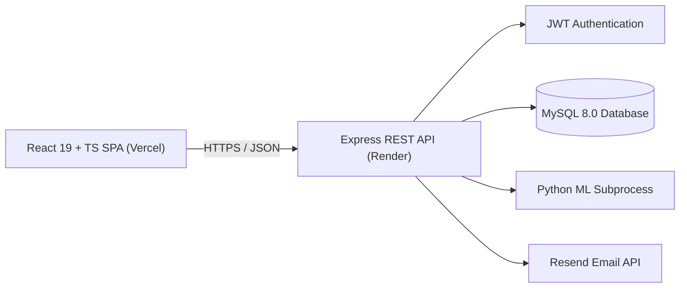
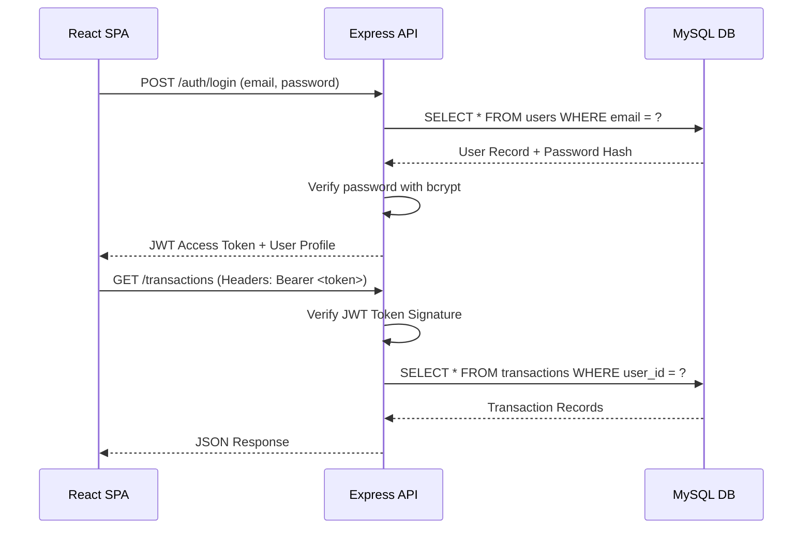
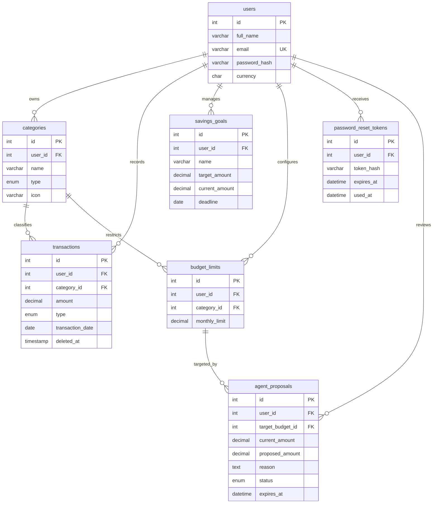

# FinSight

[](https://github.com/ShivShah018/FinSight/releases)
[](https://fin-sight-beta-dusky.vercel.app)
[](LICENSE)
[](https://react.dev/)
[](https://expressjs.com/)
[](https://www.mysql.com/)

**FinSight** is a full-stack personal finance management platform built with React 19, TypeScript, Express.js, and MySQL. It combines a bounded, human-in-the-loop agentic AI assistant, deterministic financial analytics, transparent machine learning models, and a sleek responsive dark-mode interface.

🌐 **Live Application:** [https://fin-sight-beta-dusky.vercel.app](https://fin-sight-beta-dusky.vercel.app)  
⚙️ **Backend API:** [https://finsight-backend-zsz3.onrender.com](https://finsight-backend-zsz3.onrender.com)

---

### Release `v1.1.0` Overview

FinSight **v1.1.0** introduces end-to-end conversation persistence between drawer and full-page assistant modes, an animated financial loading experience with rotating insights messages, bounded human-in-the-loop budget proposal approvals with intelligent alternatives, time-aware ML evaluation, a modernized GitHub Actions CI pipeline, and a production-grade multi-container Docker setup.

---

## Features

### 🤖 AI-Powered Financial Assistant
- **Conversational Intelligence:** Natural language financial analysis and multi-turn Q&A powered by Google Gemini with native tool-calling capabilities.
- **Bounded Multi-Step Workflow:** LangGraph-based `StateGraph` state machine with typed state, cycle limits (max 3 iterations), and deterministic fallback handlers.
- **Read-Only Financial Tools:** Grounded in actual ledger data via read-only tools (`get_monthly_spending`, `get_category_breakdown`, `get_budget_status`, etc.) without fabricating numbers.
- **Live Activity & Metrics Cards:** Visual display of tool execution stages, category spending distributions, and net cashflow metrics directly inside chat responses.
- **Human-in-the-Loop Budget Approvals:** Gemini proposes budget adjustments with explicit reasons, requiring explicit user approval before atomic execution.
- **Intelligent Alternatives on Decline:** Rejecting a proposal leaves budget limits untouched and prompts data-grounded alternatives (distinguishing flexible vs. fixed categories).
- **Persistent Multi-View Conversation:** Conversations survive seamless transitions between the embedded drawer and `/assistant` full page, preserving in-flight typewriter text and message history in user-scoped `sessionStorage`.
- **Account Isolation & Privacy:** Secure per-user session isolation ensures logout immediately purges cached conversation state, preventing cross-user data leakage.

### 📊 Analytics & Applied Machine Learning
- **Interactive Analytics & Charts:** 12-month net cashflow bar charts, monthly surplus/deficit tracking, and dynamic multi-currency rendering (`INR`, `USD`, `EUR`, `GBP`).
- **Animated Loading Experience:** Polished centered loading message (*“Crunching your numbers…”*) featuring a glowing purple gradient orb, pulsing chart bars, three bouncing indicator dots, and smooth fade transitions rotating through short insight previews.
- **Zero-CLS Skeletons & State Handling:** Layout-preserving dark-mode skeleton placeholders, independent section loading for cashflow vs. spending groups, structured retry buttons on error, and intuitive empty states.
- **Linear Regression Forecasting:** Time-series expense predictions projected from historical monthly spending.
- **K-Means Expense Clustering:** Unsupervised grouping of transaction behaviors into ranked clusters based on frequency and ticket size.
- **Chronological ML Validation:** Real-world time-series holdout evaluation without future lookahead, compared against a naive persistence baseline (last-month spending).

### 🛡️ Reliability & Engineering
- **Input Validation & Pagination:** Strict Zod schema validation across all endpoints, with bounded transaction pagination (limit capped at 100) to protect database throughput.
- **Strict JWT Configuration:** Safe secret verification rejecting insecure development fallbacks in production.
- **Health & Readiness Endpoints:** Dedicated probes (`GET /health` and `GET /health/ready`) reporting uptime, configuration state, and live MySQL database connectivity.
- **ML Subprocess Isolation & Timeouts:** Python machine learning scripts run in an isolated subprocess with graceful 20-second timeout handling and deterministic fallback outputs.
- **Automated Testing & CI/CD:** 10 backend test suites (73 tests) covering agent safety, transactional approval, and ML validation; 25 real-browser CDP tests; GitHub Actions CI pipeline; and multi-container Docker/Compose configuration.
- **Ledger Management & Security:** Full CRUD ledger with soft-delete/restore capabilities, bcrypt password hashing, and A4 PDF statement generation.

---

## Tech Stack

| Layer | Technologies & Libraries |
| :--- | :--- |
| **Frontend** | React 19, TypeScript, Vite, TanStack Query v5, Recharts, Lucide Icons, React Hook Form, Zod, Tailwind CSS |
| **Backend** | Node.js, Express.js, JWT (`jsonwebtoken`), `bcrypt`, `mysql2` (Prepared Statements), `pdfkit` |
| **Agentic AI** | LangGraph (`@langchain/langgraph`), Google Gemini (`@langchain/google-genai`), `@langchain/core`, Zod validation |
| **Database** | MySQL 8.0 (7 Relational Tables with Foreign Keys, Cascading Deletes, Unique Constraints, and Composite Indexes) |
| **Email Service** | Resend API (Transactional emails for password reset verification) |
| **Machine Learning** | Python 3, `scikit-learn` (Linear Regression, K-Means Clustering, TimeSeriesSplit) |
| **Deployment** | Vercel (Frontend SPA with URL rewrites), Render (Express.js API), MySQL Cloud Database |

---

## Architecture & System Design

FinSight uses a decoupled client-server architecture. The React single-page application communicates with the Node.js/Express backend via a RESTful JSON API. Heavy machine-learning computations are offloaded to an isolated Python service spawned on demand.



### Authentication Flow



---

## Repository Structure

```text
FinSight/
├── frontend/             # React 19 + TypeScript SPA
│   ├── src/
│   │   ├── api/          # Axios API service instances
│   │   ├── components/   # Modular UI components & modals
│   │   ├── contexts/     # Auth & global state providers
│   │   ├── hooks/        # Custom React hooks
│   │   ├── pages/        # Dashboard, Transactions, Goals, Budgets, Analytics, Insights, Settings
│   │   ├── types/        # TypeScript interfaces & types
│   │   └── utils/        # Formatting & currency helpers
│   ├── package.json
│   └── vite.config.ts
│
├── server/               # Express.js REST API Backend
│   ├── controllers/      # Route controllers (Auth, Tx, Goals, Budgets, Analytics, ML)
│   ├── routes/           # Express router endpoints
│   ├── database/         # MySQL database initialization schemas
│   ├── ml/               # Python ML scripts & evaluation pipeline
│   ├── utils/            # JWT middleware & email service
│   ├── db.js             # MySQL connection pool
│   ├── app.js            # Express app configuration & middleware
│   ├── server.js         # HTTP server entry point
│   └── package.json
│
├── vercel.json           # Vercel SPA routing rules
└── README.md
```

---

## API Overview

All protected endpoints require an `Authorization: Bearer <token>` header.

### Authentication & Account
- `POST /auth/register` — Register a new user account
- `POST /auth/login` — Authenticate credentials and issue JWT
- `GET /auth/me` — Retrieve current authenticated user profile
- `POST /auth/forgot-password` — Request password reset email
- `POST /auth/reset-password` — Reset password using token

### Transactions Ledger
- `GET /transactions` — Fetch user transactions (supports `month`, `year`, `limit`)
- `POST /transactions` — Create new transaction record
- `GET /transactions/:tx_id` — Fetch single transaction details
- `PUT /transactions/:tx_id` — Update existing transaction
- `DELETE /transactions/:tx_id` — Soft-delete transaction (`deleted_at = NOW()`)
- `POST /transactions/:tx_id/restore` — Restore soft-deleted transaction
- `GET /transactions/deleted/recent` — Fetch recently deleted transactions

### Savings Goals & Budgets
- `GET /goals` | `POST /goals` | `PUT /goals/:goal_id` | `DELETE /goals/:goal_id` — Goal CRUD
- `POST /goals/:goal_id/fund` — Deposit funds into savings goal
- `POST /goals/:goal_id/complete` — Mark savings goal completed
- `POST /goals/:goal_id/cancel` — Mark savings goal cancelled
- `GET /budgets` | `POST /budgets` | `PUT /budgets/:budget_id` | `DELETE /budgets/:budget_id` — Budget cap CRUD
- `GET /budgets/utilization` — Get category spending vs monthly limits

### Dashboard, Analytics & System
- `GET /dashboard` — Financial overview metrics and monthly summary
- `GET /analytics/trends` — 12-month historical cashflow aggregations
- `GET /categories` — Fetch available spending and income categories
- `POST /report/generate` — Generate downloadable A4 PDF financial statement
- `GET /currency/rates` — Live multi-currency conversion rates
- `GET /health` — Application health & Resend service configuration status

### Agentic AI Assistant
- `POST /agent/chat` — Bounded multi-step conversational query with Gemini native tool execution
- `GET /agent/proposals` — List pending and historical budget modification proposals
- `GET /agent/proposals/:proposal_id` — Get single proposal details with live staleness status
- `POST /agent/proposals/:proposal_id/approve` — Atomically approve and apply budget update
- `POST /agent/proposals/:proposal_id/reject` — Reject proposal without modifying budget limits

### ML Insights
- `GET /insights/predict` — Next-month spending prediction (Linear Regression)
- `GET /insights/suggest-category` — Automated expense category classification
- `GET /insights/cluster` — Behavioral spending cluster analysis
- `GET /insights/all` — Aggregate analytical data feed for ML pipeline

---

## Database Design



---

## Application Gallery

| Dashboard Overview | Transaction Ledger |
|:---:|:---:|
|  |  |

| Savings Goals | Budget Limits |
|:---:|:---:|
|  |  |

| Financial Analytics | User Settings |
|:---:|:---:|
|  |  |

---

## Local Setup & Installation

### Prerequisites
- **Node.js:** v18.0.0 or higher
- **MySQL:** v8.0 or higher
- **Python:** v3.10 or higher (Optional for ML service)

### 1. Clone Repository
```bash
git clone https://github.com/ShivShah018/FinSight.git
cd FinSight
```

### 2. Database Initialization
Import the schema into your local MySQL server:
```bash
mysql -u root -p < server/database/schema_railway.sql
```

### 3. Server Configuration & Startup
```bash
cd server
npm install
```
Create a `.env` file inside the `server/` directory:
```env
FINSIGHT_DB_HOST=localhost
FINSIGHT_DB_PORT=3306
FINSIGHT_DB_USER=root
FINSIGHT_DB_PASSWORD=your_mysql_password
FINSIGHT_DB_NAME=finsight
JWT_SECRET_KEY=your_secure_jwt_secret
API_PORT=8000
RESEND_API_KEY=re_your_resend_api_key

# Agentic AI (Google Gemini & LangGraph)
GEMINI_API_KEY=your_gemini_api_key_here
GEMINI_MODEL=gemini-3.5-flash-lite
AGENT_MAX_ITERATIONS=3
AGENT_PROPOSAL_EXPIRY_HOURS=24
```
Start the backend server:
```bash
npm start
```
*Backend server will listen on `http://localhost:8000`.*

### 4. Frontend Startup
Open a new terminal window:
```bash
cd frontend
npm install
npm run dev
```
*Frontend application will launch at `http://localhost:5173`.*

---

## Automated Testing

FinSight includes comprehensive unit, integration, security, and E2E test suites:

### 1. Server Unit, Agent, ML & Approval Security Tests
Uses Node's built-in native test runner (`node --test`). Tests tool schemas, empty data handling, anomaly detection, LangGraph state transitions, bounded iteration stops, authorization boundaries, proposal staleness checks, atomic transactional approval, time-aware ML evaluation, and deployment smoke checks across 10 suites (73 automated tests):
```bash
cd server
npm test
```

### 2. Machine Learning Time-Aware Evaluation & Clustering Tests
Tests Python `ml_service.py` subprocess execution, holdout train/test split without future data leakage, naive persistence baseline comparison, and K-Means expense clustering:
```bash
cd server
node --test tests/mlService.test.js
```

### 3. Full End-to-End Integration Suite
Tests the complete realistic user lifecycle against the running backend (46 tests):
```bash
node test_e2e.js
```

### 4. Real Browser UI & Assistant Persistence Suite (Chrome CDP)
Executes end-to-end user journeys in headless Chrome using native Chrome DevTools Protocol (CDP) on port 9222 without third-party frameworks. Verifies registration, login, drawer interactions, question sequencing, route transitions between drawer and `/assistant`, follow-ups, typewriter animation, page refresh state recovery from `sessionStorage`, and strict User B account data isolation (25 tests):
```bash
# Ensure frontend dev server is running on localhost:5173 and backend on localhost:8000
node test_browser_conversation_flow.js
```

### 5. Frontend Linting & Production Build
```bash
cd frontend
npm run lint
npm run build
```

---

## Docker & Containerization

FinSight provides container definitions for a clean, reproducible local development and testing environment.

### Backend Dockerfile (`Dockerfile`)
- **Base:** `node:20-bookworm-slim` with Python 3 virtual environment for ML execution.
- **Security:** Runs as unprivileged `USER node`.
- **Health Check:** Native HTTP probe polling `GET /health` every 30 seconds.
- **Port:** Exposes port 8000 (configurable via `PORT` / `API_PORT`).

### Docker Compose (`docker-compose.yml`)
Spins up both MySQL 8.0 and the Express + Python ML backend in an isolated bridge network:

```bash
# Start MySQL and Express Backend containers
docker compose up --build -d

# View service logs
docker compose logs -f backend

# Verify health status
curl http://localhost:8000/health
curl http://localhost:8000/health/ready

# Tear down environment
docker compose down -v
```

---

## CI/CD Pipeline (GitHub Actions)

The repository includes a modern GitHub Actions workflow at [`.github/workflows/ci.yml`](.github/workflows/ci.yml) triggered on pull requests and pushes to `main` and `develop`:

1. **Frontend Job (`frontend-ci`):**
   - Node 20 runtime with `npm` dependency caching.
   - ESLint validation (`npm run lint`).
   - TypeScript compilation and Vite production build (`npm run build`).
2. **Backend Job (`backend-ci`):**
   - MySQL 8.0 service container with health check.
   - Python 3.11 environment with `numpy` and `scikit-learn` dependencies.
   - Automatic database schema migration via `server/database/schema_railway.sql`.
   - Node native test suite execution (`npm test` — 73 tests).
3. **Security Audit (`security-audit`):**
   - High-severity dependency vulnerability audit (`npm audit --audit-level=high`).
4. **Safety & Governance:**
   - Concurrency control cancels redundant runs on new pushes (`cancel-in-progress: true`).
   - Least privilege repository permissions (`contents: read`).
   - Third-party actions pinned to audited versions (`@v4`).

---

## Hosting & Deployment Architecture

- **Frontend (Vercel):** Single-page application hosted on Vercel with client-side routing via [`vercel.json`](vercel.json). Automatically deploys production branch upon GitHub push.
- **Backend (Render):** Express API web service hosted on Render with automatic GitHub deployment hooks.
- **Database (Cloud MySQL):** Managed MySQL 8.0 database instance with connection pooling (`mysql2`).

> [!IMPORTANT]
> GitHub Actions handles continuous integration and quality gates. Actual production deployments to Vercel and Render are gated and decouple CI test verification from live deployment execution.

---

## Health Checks & Troubleshooting

### Health Endpoints
- `GET /health`: Returns basic service liveness and email provider configuration:
  ```json
  { "status": "healthy", "version": "1.1.0", "email": { "provider": "resend", "configured": true } }
  ```
- `GET /health/ready`: Probes active MySQL database connectivity:
  ```json
  { "status": "ready", "database": "connected", "version": "1.1.0" }
  ```

### Common Issues & Solutions
1. **Database Connection Refused (`ECONNREFUSED`):**
   - Verify MySQL server is active on `FINSIGHT_DB_HOST`:`FINSIGHT_DB_PORT`.
   - Check credentials in `server/.env`.
2. **Python Subprocess Timeout in ML Insights:**
   - On Windows cold starts, scikit-learn import may take a few seconds. FinSight defaults to a 20-second timeout, configurable via `ML_TIMEOUT_MS=20000`.
   - Ensure the virtual environment at `backend/.venv` (or Docker `/opt/venv`) has `scikit-learn` and `numpy` installed.
3. **Gemini AI Rate Limits (`429 RESOURCE_EXHAUSTED`):**
   - The assistant agent automatically detects quota exhaustion and provides structured, deterministic financial fallback insights using verified tool execution data without crashing.

---

## Known Limitations & Portfolio Notes

- **Model Complexity:** FinSight intentionally employs Linear Regression and K-Means clustering for financial transparency and rapid explainability. It avoids black-box neural architectures for simple monthly ledger analysis.
- **Holdout Evaluation:** Predictive accuracy is evaluated using a time-aware train/test split (no future lookahead) compared against a naive persistence baseline (last-month spending).
- **Conversation Storage:** Assistant conversations are persisted in `sessionStorage` scoped per user ID. Server-side session sync is intentionally avoided to preserve privacy and minimize database bloat.

---

## Engineering Highlights & Design Rationale

- **Agentic AI with LangGraph & Gemini Function Calling:** Unlike naive single-shot chatbot wrappers, FinSight coordinates a bounded multi-step state graph (`StateGraph`) with explicit typed state, deterministic evaluation nodes, and bounded iterations.
- **Human-in-the-Loop Financial Action Approvals:** Gemini is strictly restricted to read-only tool invocation and cannot execute budget changes directly. When financial optimization suggests a budget change, the agent generates a pending proposal stored in MySQL. Users must review and explicitly approve proposals.
- **Stale Proposal & Replay Protection:** Approval executes inside an isolated database transaction with row locks (`FOR UPDATE`). If the live budget changed since the proposal was created, the approval is rejected with HTTP 409 Conflict to protect the user's finances.
- **SQL Security & Performance:** All database interactions use prepared statements via `mysql2` to prevent SQL injection. Composite indexes (`idx_user_date`, `idx_user_status`) accelerate range queries.
- **Zero-CLS Skeleton UI:** Dedicated skeleton placeholders match the dark theme and preserve layout stability during chart and cluster data fetching.
- **Decoupled SPA / REST Architecture:** Frontend and backend are completely decoupled. The SPA communicates exclusively via JSON HTTP requests, enabling independent deployments on Vercel and Render.

---

## License

This project is licensed under the [MIT License](LICENSE).

